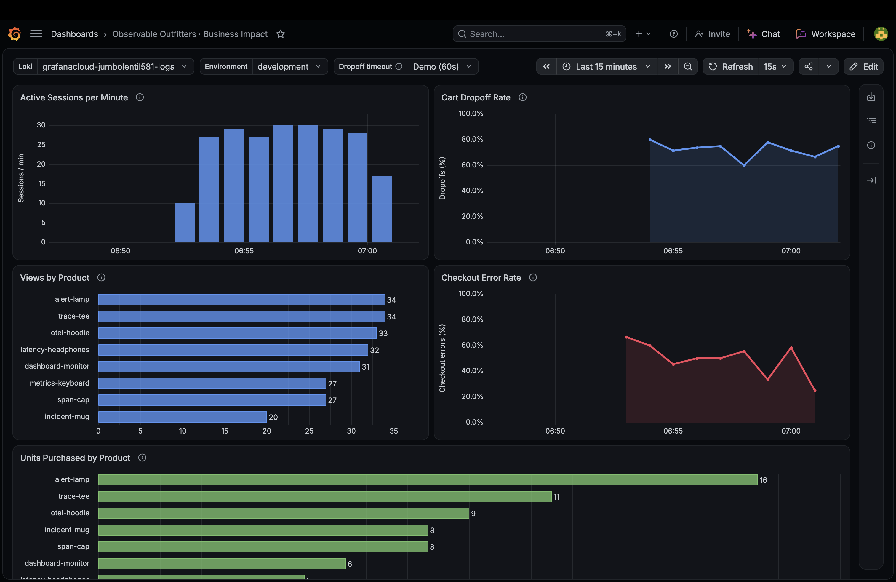

# Observable Outfitters

A Next.js storefront instrumented with Grafana Faro in the browser and OpenTelemetry in the API. Browser events go to Grafana Cloud Frontend Observability; server business logs go to Loki and traces go to Tempo through the Grafana Cloud OTLP gateway. No local collector or database is required. Carts and orders are held in memory and reset when the server restarts.



## Documentation

- [Write-up: instrumentation decisions and observed product issues](docs/WRITEUP.md)
- [Telemetry reference](docs/telemetry.md)
- [Dashboard queries and limitations](docs/queries.md)
- [Grafana dashboard JSON](docs/observable-outfitters-dashboard.json)
- [FDE take-home brief](docs/FDE%20Take-Home%20-%20Observable%20Outfitters.pdf)

## 1. Install dependencies

Use Node.js 20.9 or newer and npm. Run these commands from the app directory containing `package.json`:

```sh
npm ci
cp -n .env.example .env.local
```

Edit `.env.local` with the values from your own stack below. Next.js loads this file automatically; it is ignored by Git. The copy command preserves an existing `.env.local`.

## 2. Get your Grafana Cloud connection details

Use the same Grafana Cloud stack for both connections so browser and server activity can be investigated together.

**Browser:** In Grafana Cloud, open **Observability → Frontend** (Frontend Observability), create an application named `observable-outfitters`, and add `http://localhost:3000` to **CORS Allowed Origins**. Add your deployed origin as well if hosting elsewhere. Copy the application's collector URL, including its `/collect/…` application key, into `NEXT_PUBLIC_FARO_URL`. This URL is intended for browser ingestion; it does not contain your private Cloud access token. See [Grafana's Faro setup guide](https://grafana.com/docs/grafana-cloud/observe-and-act/monitor-applications/frontend-observability/instrument/faro/).

**Server:** In the Grafana Cloud portal, select your stack and open **OpenTelemetry → Configure** to get its OTLP connection details. Generate a stack-scoped Cloud access policy token with `logs:write` and `traces:write`. Copy the provided OTLP endpoint and authorization header. This app exports directly over HTTP/protobuf. See [Grafana's OTLP setup guide](https://grafana.com/docs/grafana-cloud/send-data/otlp/send-data-otlp/).

## 3. Configure environment variables

Replace every `<…>` placeholder in this example with your own connection details:

```dotenv
# Public browser configuration
NEXT_PUBLIC_FARO_URL=https://<your-faro-collector>/collect/<your-application-key>
NEXT_PUBLIC_APP_ENVIRONMENT=development
NEXT_PUBLIC_APP_VERSION=0.1.0

# Private server configuration
OTEL_SERVICE_NAME=observable-outfitters-api
OTEL_EXPORTER_OTLP_ENDPOINT=https://<your-otlp-gateway>/otlp
OTEL_EXPORTER_OTLP_PROTOCOL=http/protobuf
OTEL_EXPORTER_OTLP_HEADERS="Authorization=Basic <base64-encoded-otlp-instance-id:token>"
```

| Variable | Purpose / default |
| --- | --- |
| `NEXT_PUBLIC_FARO_URL` | Required for browser telemetry. Use the full Faro collector URL from your application settings. Empty disables browser telemetry. |
| `NEXT_PUBLIC_APP_ENVIRONMENT` | Environment attached to browser and server telemetry. Defaults to `development`; the dashboard also offers `test` and `production`. |
| `NEXT_PUBLIC_APP_VERSION` | Version attached to browser and server telemetry. Defaults to `0.1.0`. |
| `OTEL_SERVICE_NAME` | Backend service name; defaults to `observable-outfitters-api`. Keep this value for the supplied dashboard queries. The frontend service name is fixed at `observable-outfitters`. |
| `OTEL_EXPORTER_OTLP_ENDPOINT` | Required for the standard server setup. Use the gateway's base URL ending in `/otlp`; the exporters append `/v1/traces` and `/v1/logs`. |
| `OTEL_EXPORTER_OTLP_PROTOCOL` | Set to `http/protobuf`, matching the installed exporters. |
| `OTEL_EXPORTER_OTLP_HEADERS` | Private authentication header shared by server trace and log exports. Copy the generated value from your stack's OTLP setup. |

The Basic header encodes `<OTLP instance ID>:<Cloud access policy token>`. Use the **OpenTelemetry instance ID** from the connection details. If constructing the value manually, run:

```sh
printf '%s' '<your-otlp-instance-id>:<your-access-policy-token>' | base64 | tr -d '\n'
```

Put the resulting single line after `Authorization=Basic ` inside the quoted `.env.local` value. Base64 is reversible; treat the entire header as a secret. Keep tokens and headers server-only, without a `NEXT_PUBLIC_` prefix, and never commit `.env.local`.

Use the generic OTLP endpoint and header above for both signals. If your shell or deployment already defines `OTEL_EXPORTER_OTLP_TRACES_ENDPOINT`, `OTEL_EXPORTER_OTLP_LOGS_ENDPOINT`, or their signal-specific `*_HEADERS`, remove those overrides for this setup. Signal-specific endpoints take precedence and require the complete `/v1/traces` or `/v1/logs` path. Existing shell environment variables also take precedence over `.env.local`.

Restart the app after changing configuration. `NEXT_PUBLIC_*` values are embedded in the browser bundle during `npm run build`, so set them before building and rebuild after changing them.

## 4. Run the app

For development:

```sh
npm run dev
```

Open [http://localhost:3000](http://localhost:3000). For a production build, stop the development server, then run:

```sh
npm run build
npm start
```

The app still runs with telemetry disabled or when Grafana Cloud cannot be reached. To disable telemetry deliberately, leave `NEXT_PUBLIC_FARO_URL` and the OTLP endpoints empty; `OTEL_SDK_DISABLED=true` also disables the server SDK.

## 5. Generate and verify telemetry

Browse a product, add it to the cart, and complete checkout with test shipping details (including a valid email format) and the simulated card `4242 4242 4242 4242`. The card `4000 0000 0000 0002` always declines; quantities above five are rejected at checkout. Payments are simulated. Optional server variables `PAYMENT_FAILURE_RATE` and `SLOW_PAYMENT_RATE` both default to `0.1`; set both to `0` in `.env.local` and restart for predictable successful payments and normal latency.

To generate multiple browser sessions, keep the app running and use a second terminal:

```sh
npx playwright install chromium
npm run simulate -- 12 http://localhost:3000
```

The simulator uses local Google Chrome when available, falling back to Playwright's Chromium. It creates separate sessions with browsing, purchases, abandoned carts, stock rejections and declined payments, and allows time for browser telemetry to flush.

After ingestion, check:

- **Frontend Observability:** select `observable-outfitters` and look for sessions and custom `shop.*` events.
- **Explore → your stack's Loki data source:** query `{service_name="observable-outfitters"} | logfmt` for browser events and `{service_name="observable-outfitters-api"} | event_name="shop.checkout"` for server checkout results.
- **Explore → your stack's Tempo data source:** search for service `observable-outfitters-api`. A checkout initiated in the browser should connect `shop.checkout` → `POST /api/checkout` (client and server spans) → `payment.charge` in the same trace when payment processing is reached. Faro `session_id` also connects separate shopper actions and backend events.

If browser events are missing, check collector requests in browser developer tools, the Faro URL, and the exact allowed origin. CORS changes can take two minutes to propagate. If server logs or traces are missing, check the OTLP gateway URL, token scopes, header, and any signal-specific overrides. Allow for batching and ingestion delay, and widen the Grafana time range.

## 6. Import the business dashboard

In Grafana, open **Dashboards → New → Import** and upload [docs/observable-outfitters-dashboard.json](docs/observable-outfitters-dashboard.json). Select **your stack's Loki data source** in the dashboard's **Loki** dropdown; the saved selection comes from the original stack and may need changing. Match **Environment** to `NEXT_PUBLIC_APP_ENVIRONMENT` (or choose **All** for a custom environment).

The five panels show active sessions, cart dropoff, product views, units purchased and checkout error rate. They derive these measurements from event logs, so no metrics exporter is needed. Dropoff defaults to **Demo (60s)** of inactivity; wait at least that long after an abandoned session, plus ingestion time. Use **Normal (15m)** for the longer inactivity window and widen the dashboard time range accordingly. Empty denominators leave gaps in rate panels.

Query definitions and limitations are in [docs/queries.md](docs/queries.md). Instrumentation decisions and observed product issues are in [docs/WRITEUP.md](docs/WRITEUP.md).

## Checks

```sh
npm run lint
npm run typecheck
npm test
```

Stop any development server running from this checkout before `npm test`: Next.js prevents two development servers sharing the same build directory, even on different ports. Tests start their own app on port `3100` and a local OTLP receiver on port `3218`; keep both ports free. The test configuration replaces Cloud destinations with local receivers, so it does not populate your Grafana stack. Tests use local Google Chrome by default. To use the Chromium installed above:

```sh
PW_CHANNEL= npm test
```

Use `npm run test:telemetry` for telemetry coverage alone, or `npm run test:prod` to run against a production build.
