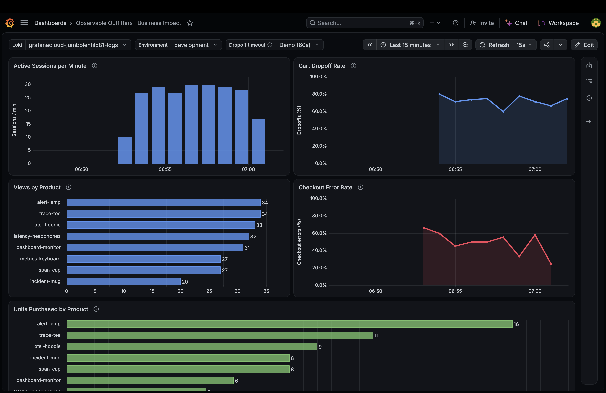

## Telemetry

### FE Events

| Signal | Capture intent | Captured fields | Code |
| --- | --- | --- | --- |
| `session_start` (Faro event) | Count new shopping sessions. | Session metadata | [SDK setup](../src/lib/telemetry.ts) |
| `session_resume` (Faro event) | Recognize a resumed session after reload. | Session metadata | [SDK setup](../src/lib/telemetry.ts) |
| `session_extend` (Faro event) | Link a renewed session to its predecessor. | Session metadata, `previousSession` | [SDK setup](../src/lib/telemetry.ts) |
| `view_changed` (Faro event) | Track transitions between named views. | `fromView`, `toView` | [View tracking](../src/lib/telemetry.ts) |
| `shop.catalog_view` (event) | Measure catalog visits by category. | `category` | [StoreView](../src/components/StoreView.tsx#L17) |
| `shop.product_view` (event) | Measure product interest. | `product_id`, `category` | [StoreView](../src/components/StoreView.tsx#L17) |
| `shop.cart_view` (event) | Distinguish visiting the cart from leaving after an addition. | Session/view/page metadata; no custom fields | [Cart page](../src/app/cart/page.tsx#L16) |
| `shop.checkout_view` (event) | Capture checkout visits before submission. | Session/view/page metadata; no custom fields | [Checkout page](../src/app/checkout/page.tsx) |
| `shop.order_confirmation_view` (event) | Confirm arrival at the receipt page; count visits, not purchases. | Session/view/page metadata; no order ID or custom fields | [Order page](../src/app/orders/[id]/page.tsx#L14) |
| `shop.cart_add` (event + span) | Measure add-to-cart success, failures, and latency. | `product_id`, `quantity`, operation fields above | [CartProvider](../src/components/CartProvider.tsx#L46) |
| `shop.cart_remove` (event + span) | Measure removals and request failures. | `product_id`, `quantity=0`, operation fields above | [CartProvider](../src/components/CartProvider.tsx#L57) |
| `shop.cart_update` (event + span) | Measure quantity changes and request failures. | `product_id`, `quantity`, operation fields above | [CartProvider](../src/components/CartProvider.tsx#L57) |
| `shop.checkout` (event + span) | Measure checkout conversion, failure reasons, and latency per attempt. | `item_count`, `total_cents`, operation fields above; `http_status` when a response is parsed | [Checkout](../src/app/checkout/page.tsx) |
| `shop.checkout_ui_failure` (event) | UI failure after order acceptance; linked to the checkout trace. | `error_code=post_checkout_refresh_failed` | [Checkout](../src/app/checkout/page.tsx) |
| `GET /api/cart`, `POST /api/cart`, `PATCH /api/cart`, `POST /api/checkout` (CLIENT spans) | Separate HTTP latency/failures from the shopper action; propagate trace context. | Method, URL, status; `error.type` on HTTP/network failure | [requestApi](../src/lib/telemetry.ts) |
| `exception` (CLIENT span event) | Identify network failures without exporting raw errors. | Fixed type/message; span `error.type=network_error` | [requestApi](../src/lib/telemetry.ts) |

### BE Events

| Business event | Shows | Fields |
| --- | --- | --- |
| `shop.cart_add` | Successful server cart additions. | `outcome`, `product_id`, numeric `quantity` |
| `shop.checkout` | One completed API checkout request. | `outcome`, `result=accepted/rejected/error`, `failure_kind`, `error_code`, `payment_error_code`, `http_status` |
| `shop.product_purchased` | Quantities in saved orders, including lost browser responses. | `product_id`, numeric `quantity` from the server cart |

| Signal | Capture intent | Code |
| --- | --- | --- |
| `GET /api/products` (span) | Measure catalog API latency and availability. | [Products API](../src/app/api/products/route.ts#L5) |
| `GET /api/products/[id]` (span) | Measure product lookup latency and missing-product responses. | [Product API](../src/app/api/products/[id]/route.ts#L4) |
| `GET /api/cart` (span) | Measure cart load/refresh latency and failures. | [Cart API](../src/app/api/cart/route.ts) |
| `POST /api/cart` (span) | Measure add-item requests and rejected products. | [Cart API](../src/app/api/cart/route.ts) |
| `PATCH /api/cart` (span) | Measure quantity-update/removal requests. | [Cart API](../src/app/api/cart/route.ts) |
| `DELETE /api/cart` (span) | Measure explicit cart-clearing requests. | [Cart API](../src/app/api/cart/route.ts) |
| `POST /api/checkout` (span) | Measure server checkout latency/outcome; `shop.error_code` distinguishes missing shipping, empty cart, stock rejection, and payment decline. | [Checkout API](../src/app/api/checkout/route.ts) |
| `exception` (SERVER span event) | Expose uncaught handler failures; record sanitized type, fixed message, and stack frames, with span `error.type`. | [recordException](../src/lib/server-telemetry.ts) |

## Business dashboard

- [x] Active Sessions per Minute: distinct sessions with recorded events per minute.
- [x] Cart Dropoff Rate: inactive cart sessions without an accepted order (%).
- [x] Views by Product: views over the selected range, including repeats.
- [x] Units Purchased by Product: units in saved orders over the selected range.
- [x] Checkout Error Rate: API responses with HTTP status ≥400 / completed checkout requests (%).

Full dashboard queries: [queries](queries.md).
